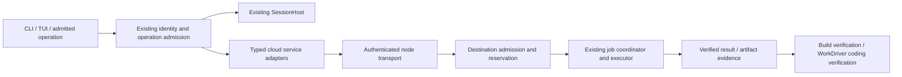

# harw-cloud integration: executable delivery plan

**Status: DRAFT / PLANNED.** Documentation only; no cloud service, remote writer,
automatic placement or deployment is enabled. Review date: 2026-10-29.

This is the current integration slice of the existing
[cloud control contract](04-cloud-control-contract.md) and
[Rust integration map](05-rust-integration.md), not a second cloud architecture.
The dossier's 2026-10-16 evidence remains historical. For the cloud paths below,
this refreshed source inspection supersedes historical missing-source claims.
Unrelated host-inventory work and historical gap IDs retain their existing scope.

## 1. Pinned CURRENT state

Implementation baseline: `dev@fcb12b41f5e53c19cc20607a63c98b829452b505`.
Coordination inputs: [#153](https://github.com/mm9942/Harwness/pull/153) at
`ec3f70bdfc84613b12d0b769457e6b00826c556e`, and
[#154](https://github.com/mm9942/Harwness/pull/154) at
`ed0aaaa0c9a49c47cb7d6b242b8de1b0c95dd92e`, including PL-97 section 8.
Those PRs are unmerged inputs, not features on this baseline. Refresh refs before
implementation and record the consumed commit for each dependency.

| Evidence in the baseline | Consequence for implementation |
| --- | --- |
| All five `harw-cloud` packages exist; `harw-runtime` depends on `harw-cloud-ops`. `CloudOpsContributor` is in the default contributors and registers seven operations for UIA with a nonempty operation surface (`harw-runtime/src/contributors.rs`, `harw-cloud/harw-cloud-ops/src/lib.rs`). | Restoration is not the task. Verify real composition, including CommandsOnly versus AllWithModelTools and child-role restrictions. |
| `install_operation_model_tools` constructs `OpContext::new` without a tenant binding; `OpContext::new` initializes tenant to `None`. Workspace identity is a separate trusted input (`harw-runtime/src/assembly.rs`, `harw-operations/src/context.rs`). | HC1 must carry trusted identity into its actual composed service/context path. Hand-constructed tenant-scoped unit fixtures alone do not prove model-call isolation. Preserve intentional single-user behavior explicitly; missing identity must not imply fleet-wide access. |
| Assembly already resolves `ResolvedHomeContext` and maps it to Slash/ModelTool/Web/Job service surfaces (`harw-runtime/src/services.rs`). | HC1 consumes that binding rather than creating another home/profile resolver. |
| `harw-node-listener/src/identity.rs` supplies `DeviceRegistry::scan`; `harw-cli/src/device_cmd.rs` already lists and revokes devices under the selected profile. `session_serve_remote.rs` wires live revocation. | Reuse this identity/storage path. Do not add a cloud-only device database or parser. |
| Cloud `enrollments.rs` independently reads six fields in device/node order and uses `profiles/default`; canonical records use node/device order with optional seventh approval field. | Resolve home/profile at assembly and use the canonical reader, preserving rejected-row diagnostics and tenant visibility. |
| Cloud mutation handlers invoke `harw-ctl` with blocking `Command::output`; the shipped source binary is `harw-cloudctl`. Its enroll/revoke dispatch is systemctl enable/disable, not device enrollment. Matching cloud service/install assets were not found. | Separate device identity from service lifecycle and bind operations to an explicit service adapter. Renaming the executable alone is not sufficient. |
| Gateway status marks any accepting loopback port as running. `proxy.rs` explicitly contains a placeholder. | TCP reachability is only an observation. Neither readiness nor authenticated routing is implemented by these adapters. |
| `harw-cloud-enroll` contains DTOs and pairing comparison; no production caller of `validate_pairing` was found. Existing authenticated node/session ingress and `harw-reverse-proxy` policy already exist outside this subtree. | Compose existing mechanisms; pairing issuance/consumption and gateway I/O remain work to implement and prove. |
| `harw-placement-model` has offers and filtering; its module documentation leaves requirements/grants/scoring to future work. OCI/K8s executors are callable backends with restriction read-back. | Offers are not reservations. Backend code alone does not establish production remote-worker selection or destination filesystem isolation. |
| WorkDriver calls `run_turn` in-process; PL-97 E1/E2 is the process-chain dependency. | A cloud job scope does not contain in-process writes. Remote coding requires both #153's writer boundary and #154's verified execution chain. |
| `harw-core/src/admission.rs` persists an admitted `StoredJob` as Ready. Separately, process `Coordinator::submit_with` creates/claims a record and launches a `JobSpecEnvelope` (`harw-job-runtime/src/coordinator/runner.rs`). | These are distinct current paths, not an already-composed remote submission chain. HC5 must deliver their ownership/mapping bridge. Existing remote-tool forwarding is not durable remote job submission. |

## 2. Target and ownership

The first useful increment lets an operator inspect the selected cloud profile,
see truthful readiness, manage its explicitly configured service, and attach an
authorized device to the existing session owner. The subsequent execution
increment submits one build to one explicitly selected enrolled worker, verifies
its artifacts, and exposes cancellation/recovery through existing jobs. Coding
workers follow only when #153's write and central-verification gates pass.



Cloud owns discovery, connection lifecycle and context-bound adapters. SessionHost
owns the transcript. The existing coordinator/store owns job attempts; the
destination owns effects and enforcement. #153 owns coding admission, durable
supervision, in-process mutation enforcement and integration of verified results.
#154 owns the process chain and node-local enforcement reports. Placement may
select an eligible destination later; it does not replace any of these owners.

Keep packages in the existing architecture layers and run `xtask gates arch` for
every new edge. Generic job/placement types must not depend on cloud operations,
plan-bridge, session UI or DoD policy. Cloud does not gain Warden authority or an
engine socket. Preserve `unsafe_code = "forbid"`, existing Full Access semantics,
explicit deny rules, shrinking child rights and offline local operation.

## 3. DELTA: ordered work packages

Each row is independently reviewable. “Parallel” permits work on the named owned
files; shared composition edits wait for the named dependency and a refreshed ref.

| ID | Delivery / main files | Dependency and acceptance gate |
| --- | --- | --- |
| HC0 | Freeze baseline and add composed contract tests around cloud registry surfaces and injected adapters. Reconcile historical claims in PL-65/66, cloud-onboarding and this dossier. | Can start now. No fabricated service, successful TCP connect or mocked policy is called operational readiness. Record feature matrix and exact tested SHA. |
| HC1 | Context-bound read-only device/status adapter in `harw-cloud-ops`; reuse `DeviceRegistry::scan`, resolved home/profile and operation caller context. Add bounded diagnostics. | Can proceed parallel to HC2's adapter design. C02/C04/C17 from the existing verification matrix: six/seven-field records, nondefault profiles, tenant filtering, malformed rows, absent/unreadable state. Assert the exact caller tenant/profile reaches the injected service; missing services never fall back to environment/default profile. CommandsOnly exposes no cloud model tools and children get no cloud operations. An unrelated listener is never ready. |
| HC2 | Separate typed service lifecycle from device lifecycle; remove ambiguous shell wrapper behavior. Use existing service-management conventions and shipped assets. If a helper process is necessary, use the governed command path, bounded output/deadline/cancellation. | Agree unit name and user/system scope before assets. Mock adapter tests must assert actual arguments/effects, not a list of command names. C03 plus denial/ask/full tests; zero side effects on refusal; missing unit and timeout are explicit failures. No install or status probe silently starts a service. |
| HC3 | Enrollment adapter over existing registry/AuthHub/node lifecycle: injected clock, durable one-use pairing transaction, revocation revision and live/queued cleanup. | Reuse HC1 context binding. C05/C06: concurrent consumption, expiry boundary, crash/replay, revoked reconnect, rights narrowing and bounded live revocation. Preserve working `harw device` behavior and report incomplete offline cleanup. |
| HC4 | Compose authenticated existing session/node ingress with `harw-reverse-proxy` routing policy; select an I/O adapter rather than reimplement policy in the Pingora placeholder. Ship matching opt-in service/config/install assets. | HC2/HC3 and protocol review. C07/C14/C17: one session owner, spoofed identity headers refused, route/upstream allowlist, WS origin/subprotocol, bounded streaming/reconnect, real mounted feature configuration. Disposable-host install/start/stop/uninstall and rollback. |
| HC5 | Explicit single-node remote build using destination-local durable job admission/coordinator; context-bound workspace alias, immutable source/artifacts, private output/scratch roots and result verification. Add deny-only request/schema scaffolding before enabling effects. | Requires authenticated ingress plus #154 scoped execution/readiness and #153 admission/recovery contracts. J02/J04/J06 and C12/C13: no backend means zero starts, successful output creation, source/sibling/shared-Git-state write refusal, alias/traversal and cross-attempt isolation, quota enforcement, deduplication after lost ACK, partition/restart/revocation, verified artifacts and cleanup after reconciliation. Remote coding additionally requires #153's in-process writer gate and central verifier. |
| HC6 | Opt-in placement over existing offer types plus shared reservation/admission. Add filtering before scoring, accounting and node-health expiry. | Only after HC5 passes on the supported real backend. J01/C09: two clients contend for one slot, stale/revoked/draining node rejected, offer expires between selection/start, lease loss and failed launch reconcile capacity. Provider permits and node slots are separate budgets. |

HC1 is the first code PR: correct device listing and truthful read-only diagnostic
composition, with no automatic remote execution. HC2 should not be combined with
HC3 merely because today's CLI conflates their names. HC5 starts with a declared
source snapshot and build command; it does not replicate the user's home or let a
remote absolute path choose local access. Automatic provisioning, live migration,
silent session-owner failover and mandatory OCI/K8s adoption are deferred.

Concrete reuse and test seams:

- HC1 uses the existing `ResolvedHomeContext` service binding. Define trusted
  caller visibility explicitly and test it through actual assembled operations;
  do not accidentally change all operations' single-user tenant semantics.
  Conflicting process environment cannot redirect a bound profile. Bound rows and
  rejected-line diagnostics before exposing them to a model.
- HC2 evaluates `harw-install::ServiceManager`/`ServiceSpec` and existing CLI
  lifecycle conventions before adding an adapter. Current user-service assets
  serve `harw-serve`/`harw-gateway`, not a cloud gateway. Tests assert exact unit,
  user/system scope, verb, deadline and error mapping through an injected manager.
- HC3 evaluates the existing durable `harw-channel::PairingStore`, already used
  by `harw connect`/Telegram, for reusable one-use/expiry/locking mechanisms.
  Its channel identity is not device enrollment or an atomic registry/peer-pin
  commit; document any mismatch instead of copying the primitive. Preserve
  `harw device set-tier` as well as list/revoke. Existing SessionHost revocation
  already drops queued input and cancels tool calls; unavailable cleanup counters
  are not evidence of absent cleanup. Test polling-plus-close-grace bounds,
  unreadable registry, restart and each separately owned authority domain.
- HC4 tests actual HTTP/WebSocket I/O after shared policy decisions, including
  rejected requests and sanitized headers. Pure routing-policy unit tests alone
  cannot establish gateway integration.
- HC5 defines the bridge from admitted WorkId/request to destination JobId,
  attempt and lease before enabling either submit path. HC6 shares its reservation
  API; existing `NodeOffer::eligible_runtimes` freshness/activity/rootful filters
  do not reserve capacity or establish permission.

## 4. Contracts that make the integration effective

### Readiness

Expose the four common states **installed / configured / running / ready** with
component evidence and freshness, rather than another ambiguous boolean.
Installed means the selected binaries/assets exist; configured means validated
profile/routes/identity bindings; running means the expected service is observed;
ready is specific to the requested operation. A session-attach readiness check
does not imply coding-worker readiness. Worker readiness additionally requires
authenticated peer, compatible protocol, bound workspace, live capacity admission
and all requested execution dimensions. Use PL-97 E5 evidence where applicable.
Missing, stale, unknown and unsupported stay distinguishable. Diagnostic data is
not a portable authority grant and must be revalidated at the effect boundary.

### Admission, identity and scope

Resolve tenant, device, node lifecycle, active profile and maximum rights from
trusted context at both ingress and destination. A serialized scope is a ceiling,
not authorization. Bind request ID, WorkId, attempt, lease generation, source
digest and destination workspace mapping. Keep the existing required
`JobSpec.scope: JobScopeId` authority namespace distinct from the proposed
`write_scope: Option<VersionedFileScope>` ceiling. Preserve absent versus
present-empty write scope and an explicit envelope/payload version migration;
legacy v1 retains its authority namespace with no write ceiling, while old readers
must refuse new scope-bearing envelopes instead of stripping restrictions.
Reject unknown or unsupported required
dimensions before any process starts. Never widen to a writable workspace or
silently fall back to another host/backend. For source/coding leases, existing-file
writes come first; creating source files, links and renames requires a separately
proven scope contract.

Builds require a distinct output/scratch contract before HC5 effects are enabled.
Trusted destination code provisions fresh per-attempt writable roots, separate
from read-only source and source-write leases, with quota and lifetime bounds.
Reject alias/symlink escapes and access to another attempt; accept only declared
regular-file artifacts after path and content validation. Reconcile ambiguous
effects before cleanup. This grants no parent-directory writes or file creation
in source. If a backend cannot enforce these mappings and bounds, refuse start.

### Durability, cancellation and evidence

Name one owner for each admitted WorkId and its destination execution attempt.
Persist the mapping to the process JobId/lease in the admission-to-execution
adapter, and specify which store handles cancellation and recovery at each side.
Do not independently submit the same request through the Ready-job worker and
the immediate-launch coordinator. The bridge reuses the existing lifecycle;
it is not another scheduler. Local process recovery and tool-call forwarding
remain useful mechanisms but do not prove the new remote request protocol.

Persist accepted request/attempt mapping and reserve capacity before launch. A
lost acknowledgement leads to lookup/reconciliation by immutable attempt/backend
identity; it must not trigger a blind duplicate start. Fenced transitions reject
stale owners and late conflicting results. A transport disconnect detaches the
client; explicit cancellation, lease expiry and revocation have separate defined
effects. If effect completion cannot be determined, report an unknown state and
reconcile before releasing capacity or resubmitting. Do not promise exactly-once
effects merely from request deduplication.

Return bounded logs and artifacts bound to tenant, source revision/digest, target
platform, attempt and policy revision. Validate provenance and content before
#153's central verification/integration. Remote text is untrusted evidence, not an
instruction or a success proof. Keep secrets and pairing material out of model
output, ordinary logs and persisted transcripts; use existing secret capabilities.

## 5. Parallel execution and shared-file coordination

| Lane | Exclusive initial scope | Handoff |
| --- | --- | --- |
| Cloud adapters | `harw-cloud/*` and cloud-specific tests/documents | HC1/HC2 publish typed adapter contracts and focused tests. |
| Identity/ingress | canonical device/session listener and proxy integration tests | Review HC3/HC4 against existing consumers; do not fork their identity semantics. |
| #153 | cycle/WorkDriver admission, writer boundary and central verification | Supplies tested scope/admission/recovery contract to HC5. |
| #154 | E1/E2/E3/E5 execution chain, installation and enforcement reports | Supplies tested destination enforcement and readiness evidence to HC2/HC5. |
| Integrator | runtime contributors/assembly, operation surface, config merge, install/release assets and plan ledger | One owner at a time; rebase on agreed upstream slices and run composed tests. |

The lane split is proposed ownership, not a lock. Before edits, record exact
files/heads in #153/#154 and the cloud PR. Exchange small commits plus tests,
not descriptions of supposed completion. No cloud task concurrently rewrites
`harw-runtime/src/assembly.rs`, config merge or install assets while a PL-97 owner
is editing them. Independent adapter work and plan review can proceed immediately.

## 6. Verification ledger and rollout

Source audit used Sol 6.1 and Terra 6.1 independently. Baseline default-feature
tests ran with Rust 1.98.1 on `ec3f70bd` (the same cloud code as `dev@fcb12b41`;
only #153 planning edits were dirty):

```sh
cargo test --locked -p harw-cloud-enroll -p harw-cloud-gateway \
  -p harw-cloud-ops -p harw-cloudctl
```

**Observed: 21 unit tests and one doc test passed.** This does not cover the
proxy feature, composed runtime, real service manager/AuthHub, destination kernel
enforcement or live remote execution. Existing CLI verb tests do not actually
exercise service dispatch. Track those as missing evidence, not failing deployed
capabilities or inferred passing integration.

Source equivalence was checked: `fcb12b41..ec3f70bd` changes only the #153 planning
document; dependency source, manifests, lockfile and toolchain are identical.

Four additional Luna zones reviewed config/runtime, identity, execution/placement
and install/proxy in parallel. Sol checked and consolidated their evidence; Terra
reviewed architecture and build-output isolation. Their source-only review added
the context-binding, admission bridge and reuse seams above; it is not additional
runtime test evidence.

For each implementation PR record commit, clean/dirty state, platform, features,
commands, results and log references. Run focused unit/composed tests first, then
the current CONTRIBUTING matrix (format, clippy, nextest or workspace tests, doc
tests, xtask gates, dependency checks and applicable DoD/platform checks). Required
host cases use real bwrap/trampoline/Landlock/delegated cgroups, or the separately
declared equivalent backend. Mocks prove routing/refusal, not enforcement.

Roll out diagnostics, service/device control, authenticated attach, one opt-in
build worker, then opt-in coding/placement in that order. Promote each only on
its acceptance evidence. Disable new admission first on rollback; reconcile or
cancel owned attempts through their existing lifecycle instead of abandoning
running jobs or erasing identity records. Cloud outages must leave local session
work and ordinary host administration usable.

## 7. Decisions and implementation status

Before HC2/HC4 effects, settle the initial topology (user service or configured
system service), canonical unit/binary assets and chosen gateway I/O adapter.
Before HC5 activation, settle the explicit first worker/backend, artifact transfer
and retention policy, trusted workspace mapping and capacity budget. These choices
do not block HC0/HC1. Preserve existing ask/auto/full behavior rather than adding a
second approval policy. No production service or remote job is started by this plan.

Implementation status: **all HC0–HC6 deliveries remain planned**; the bounded
source audit and baseline tests above are completed evidence only. Consult
[the existing verification matrix](06-verification-and-rollout.md) for the test
IDs referenced here, and [the parent contract](04-cloud-control-contract.md) for
broader directory, inference and host-resource requirements.
