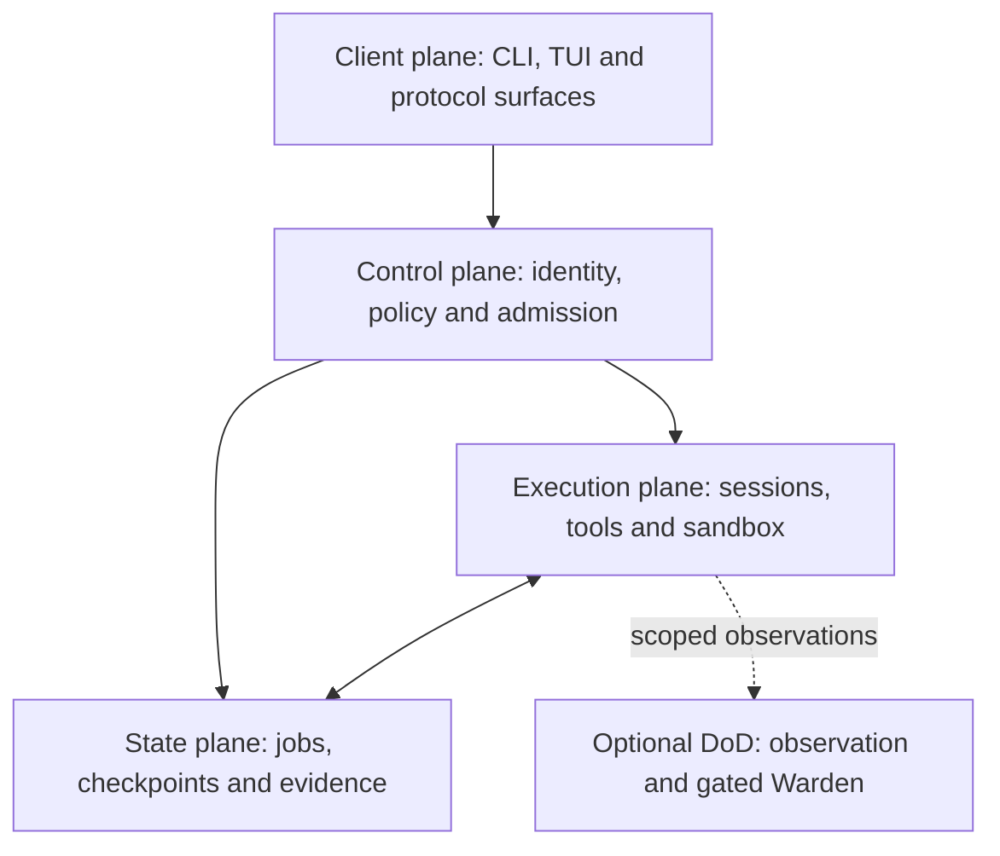

# Harwness: Policy-First Composition and Durable Execution for Model-Heterogeneous Agents

**Mia**[^1]  
**Architecture and implementation report — Preprint v1.0 — 30 October 2026**

[Read the typeset paper](harwness-paper/harwness-paper.pdf) · [Editable LaTeX source](harwness-paper/source/harwness-paper.tex)

## Abstract

Tool-using language models can propose actions, but a proposal does not establish the identity, authority, isolation, or durable state required to execute it responsibly. Harwness is a Rust-based agent runtime that places these responsibilities outside the model. This paper presents a source-grounded analysis of its architecture at a fixed repository revision. The system combines ingress-derived runtime profiles, typed principals, compiled agent definitions, attenuated delegation, governed process execution, and persistent work coordination. Its agent compiler lowers versioned definitions into a typed intermediate representation, performs eight ordered validation and resolution passes, and emits portable artifacts or native executables. Its adaptive execution substrate separates model proposals from trusted admission, journals effects before dispatch, fences stale workers, and treats completion as a candidate requiring a distinct acceptance decision. Linux execution uses backend-specific isolation and reports achieved enforcement rather than assuming that requested policy was enforced. An optional host-security subsystem adds eBPF observation, with a separately gated privileged enforcement path whose authorization integration remains incomplete. We distinguish source-observed mechanisms, limited integrations, attributed validation reports, and proposed experiments. The live adaptive-cycle recipe is read-only, while a bounded exact-file editing pilot produces review artifacts; other governed coding paths remain available. No new benchmark results are claimed. The contribution is a traceable systems account and falsifiable evaluation protocol for composing model-independent authority and lifecycle boundaries.

**Artifact:** [`mm9942/Harwness@14082d16`](https://github.com/mm9942/Harwness/commit/14082d16b5e21f920acd2dc0b84ebd42f32ac859) (workspace 0.10.0).  
**Keywords:** agent runtime; authority attenuation; durable execution; agent compilation; Linux isolation.  
**Status:** technical preprint; not peer reviewed.

## 1. Introduction

An agentic application is not just a language model with a longer prompt. It includes software that decides which tools exist, identifies their caller, interprets arguments, acquires credentials, creates processes, changes files, persists work, and determines whether a requested outcome has actually been reached. Reasoning-and-action methods such as ReAct make the interaction loop explicit, and code-based action interfaces expand what that loop can express \[1, 2\]. Neither an expressive action language nor a persuasive completion message, however, is itself an operating-system permission or a durable record of an external effect.

This distinction becomes more important as agents outlive a single model response. A parent delegates to children; a worker is restarted; a provider becomes unavailable; context is compacted; a remote client reconnects; a command succeeds just before the runtime crashes. Each event raises a systems question independent of the model’s reasoning quality. Which authority does the replacement worker inherit? Can it repeat an uncertain side effect? Does a returned patch represent an accepted change, a proposed change, or only text? Does a sandbox label describe a requested policy or an observed enforcement level?

Harwness addresses these questions through a policy-first harness. Its governing design stance is that model output is a proposal to a runtime, rather than a source of authority for that runtime. At the reviewed revision, a common composition layer assembles entry-specific policy, tools, providers, state, and delegation. Definitions of agents are compiled into typed artifacts. Durable job and adaptive-cycle components carry lifecycle information outside the conversation. Linux executors mediate operating-system access, while the optional Detect–Orient–Defend (DoD) subsystem observes selected host activity through a distinct security path \[3–7\].

Multi-agent coordination is an established design space, with frameworks already providing tools, orchestration, memory, and sandbox integration \[8\]. The question studied here is how to make the boundaries between definition, authority, execution, and evidence explicit and compositional in one evolving system. A stronger model should be replaceable without silently changing those boundaries. Conversely, even a correct authority check does not make an allowed action semantically wise.

This paper makes three bounded contributions:

1.  A source-grounded description of the current Harwness compilation, runtime, sandbox, and durable-work architecture, with immutable references and an implementation-status matrix.

2.  A set of explicit intended invariants and failure boundaries connecting definition-time checks to runtime admission, operating-system enforcement, recovery, and completion acceptance.

3.  A prospective evaluation protocol that separates useful task completion, prohibited effects, crash recovery, and observation quality. The protocol includes negative tests, ablations, uncertainty reporting, and artifact identity.

The study is an architecture and implementation report. It does not present new measurements of task success, security, latency, or cost. The review found substantial implementation and reported local validation, but did not independently build or execute the Harwness runtime. The compiler provides a developed definition-to-artifact pipeline, while some adaptive writing, deployment, and privileged enforcement paths retain integration limits. Both the implemented mechanisms and their limits are part of the systems account.

## 2. Artifact, Method, and Claim Discipline

### 2.1 Pinned artifact and evidence hierarchy

The artifact is the repository at commit 14082d16, with the full identifier recorded in Appendix A. Its workspace metadata declares version 0.10.0, Rust edition 2024, a minimum Rust version of 1.89, and MIT-or-Apache-2.0 software licensing \[3\]. These are source metadata, not evidence that every supported configuration builds. The manuscript and its preparation package have a separate license statement in the end matter.

The review resolved the current `dev` head through GitHub and compared all 35 intervening commits against the preceding manuscript’s baseline, `df08fc77`. Representative source paths were selected around authority construction, admission, effect dispatch, persistence, recovery, and privileged execution. Each major implementation claim was mapped to the relevant file and symbol at the pinned revision; Appendix A provides the source map. The review distinguished executable logic from comments, tests, operational documents, accepted architecture decisions, and plans. It also examined repository and pull-request validation records and checked platform semantics against primary Linux documentation. No runtime tests were executed as part of this study.

The analysis follows the repository’s evidence hierarchy, giving current source and Cargo metadata precedence over tests, operational documents, architecture decisions, and planning documents. Source comments identify intended contracts; the cited implementation is the review anchor for a behavioral claim. A selected-path review cannot establish complete mediation across every possible call path, and static inspection does not substitute for execution evidence.

Documentation drift is material. The repository’s older research draft names an October 7 baseline, `90160f4f`, while the present study analyzes 14082d16. The compiler’s actual pass list also includes `DeriveRequirements`, absent from a shorter introductory summary. Current implementation and repository history therefore take precedence over these older status descriptions \[5, 9, 10\].

### 2.2 Four evidence levels

Four evidence levels are used throughout. *Source-observed* means that a concrete implementation is present in the reviewed paths. *Limited integration* means that the implementation is restricted, gated, or not connected to all intended live paths. *Reported validation* means that a repository or PR records test execution that this study did not reproduce. *Prospective* identifies a design goal or experiment rather than a result. An implementation can occupy more than one level: a validator may be source-observed while its deployed integration remains limited.

Test counts in Section 9 are attributed reports, not a new benchmark dataset. The existence of a test is weaker evidence than its execution; test execution is weaker than coverage of the claimed threat model; deployment status is a separate property from both. These distinctions constrain how the architecture, implementation status, and proposed experiments should be interpreted.

### 2.3 Research questions

**RQ1: authority.** Can agent definitions and delegation preserve useful expressiveness while preventing model-controlled data from expanding runtime authority?

**RQ2: recovery.** Can durable state and effect reconciliation avoid silent work loss or blind repetition after interruption?

**RQ3: enforcement.** Can requested sandbox policy be matched to actual backend capabilities without overstating isolation?

**RQ4: evidence.** Can the system distinguish proposal, admission, execution, verification, and acceptance across models and interaction surfaces?

The current artifact supplies mechanisms and explicit limitations relevant to these questions. Controlled experiments remain necessary to answer them quantitatively.

## 3. System Model and Trust Boundaries

### 3.1 Components and responsibilities

Figure 1 is an architectural abstraction; it does not assert deployment completeness for every connector. The client plane includes local and remote entry surfaces. The control plane constructs trusted identity, reduces policy, assembles the tool and operation registries, selects providers, and admits work. The execution plane contains model sessions, delegated workers, tools, and governed process backends. The state plane retains sessions, jobs, checkpoints, artifacts, and selected memory independently of prompt history. DoD is an optional peer subsystem with separate authority, rather than an implicit extension of ordinary model privileges.



**Figure 1.** Conceptual separation of planes. Solid arrows indicate ordinary coordination or state flow; the dashed arrow indicates scoped observation. The drawing does not assert equivalent integration across entry surfaces or active privileged enforcement.


**Source-observed.** `RuntimeAssembly` is the shared composition path. Its assembly sequence includes caller narrowing, trusted configuration, project discovery, sandbox and egress policy, a context ceiling, tracing and spawn context, approval, tool and operation registries, providers, contributors, and runtime services \[4\]. The related `EntryKind` enumeration contains thirteen variants, including `SessionHost` and `CompiledAgent`. Entry kinds preserve distinctions between a web server, a job worker, and an interactive terminal instead of treating them as interchangeable front ends.

The entry profile is a reduction table, not permission supplied by a model. For example, `SessionHost` has a read/write/process ceiling without network, further narrowed by the connection tier. A compiled agent derives effective rights from its embedded manifest; the generic fallback is not a permissive default. Network permission in a root profile is also only a ceiling: configured egress scope and downstream tool reachability still matter \[11\]. These mechanisms support policy composition, although the user-facing surfaces do not all provide a complete equivalent workflow.

### 3.2 Threat model

The adversary may control repository content, retrieved text, tool-returned data, generated agent definitions, child-agent outputs, or model proposals. Such inputs may request undelegated tools, broaden a file or network scope, forge a completion claim, replay a stale request, or exploit ambiguity between an admission and a side effect. The model may also err without an adversary. Concurrency, crashes, expired leases, and unavailable dependencies are part of the failure model.

The trusted computing base includes ingress authentication, authority construction, policy and admission code, relevant persistence and executor implementations, selected sandbox components, and the operating system. Trusted code can construct a principal through the intended API; the type system is not an adversarial isolation boundary against malicious code already executing with runtime privileges. A compromised kernel, arbitrary compromise of the trusted runtime, and hardware side channels are outside the protections presented here. Remote provider behavior, data retention, and availability are separate deployment risks.

Application-level capabilities in this paper are grants to perform scoped operations. They are distinct from Linux privilege capabilities such as `CAP_BPF`. The terminology follows the broader protection literature, but no unforgeability theorem is claimed for the entire Rust application \[12\].

### 3.3 Authority attenuation

**Source-observed.** `Principal` has private fields, is serializable for reporting, and deliberately lacks `Deserialize`. It is constructed at trusted ingress or derived from a parent. The current child constructor sets the permission tier to the minimum of the parent tier and `Operator`; role names supplied as data do not deserialize into an authoritative principal \[13\].

A useful analytical model is a rights tuple $$A = (T, F_r, F_w, N, D, C, B),
  \tag{1}$$ where $T$ is the tool/operation set, $F_r$ and $F_w$ are readable and writable resources, $N$ is network scope, $D$ is the delegated target set, $C$ is the context ceiling, and $B$ contains ordered limits such as depth and remaining budget. For grants with the same resource interpretation, define $A' \preceq A$ by set inclusion for scoped dimensions and non-increase for ordered limits. This is an analytical model of the contracts; the repository does not expose one universal lattice type.

For ordinary delegation within that common resource interpretation, the intended composition rule is $$A_{\mathrm{child}} \preceq
  A_{\mathrm{parent}} \wedge A_{\mathrm{definition}}
  \wedge A_{\mathrm{role}}^{\mathrm{effective}}
  \wedge A_{\mathrm{admission}}.
  \tag{2}$$ The meet notation expresses simultaneous restrictions. The effective role ceiling includes any explicitly authorized role exception, such as the WorkDriver exception discussed in Section 4.2. Exact definition grants, remaining depth, and current runtime admission still constrain reachability. The notation does not authorize an exception or establish that every implementation path enforces all dimensions.

`AuthorityContext` uses restriction/intersection and child-subset checks. A separate trusted derivation permits a same-tenant, harness-owned read-only view with a different workspace binding, without write, execution, or network rights \[14\]. Because that derivation changes the resource binding, it requires its own admission conditions and is not covered by an unqualified same-resource subset assertion. A test model must include both this read-view exception and the effective WorkDriver role ceiling instead of assuming that all workspace identities and generic role ceilings remain unchanged. Approval resolves whether an already eligible request may proceed; it must not manufacture a missing capability. Exhaustive confirmation of these contracts remains an evaluation target.

## 4. Compiling Agent Definitions into Policy-Bearing Artifacts

### 4.1 Definition language and intermediate representation

**Source-observed.** The Harwness DSL front end parses TOML, resolves layered definitions and authority constraints, and lowers them into `AgentIr` version 2. Six authority roles are sealed in Rust: user-interface agent, root orchestrator, child orchestrator, worker, UIA worker, and agent steward. Specialization is configurable; the root role vocabulary is not freely extensible through TOML \[15\].

This distinction separates behavior from authority. A definition may specialize a worker for repository exploration without creating a new privilege class. Organizational structures parsed by the DSL should not be confused with a complete executor for every declared clan, cell, or family: the front-end source expressly limits those semantics. Similarly, a schema that can represent a fork or a write request does not imply that the active runtime admits it.

The IR uses strict typed structures and the versioned BLAKE3 snapshot domain `harwness.agent-ir.snapshot/v7`. Its canonicalization sorts set-valued lists while retaining ordered-list semantics, and omits trace and snapshot fields from the hashed representation. Covered information includes identity, instructions, skills, manifest, execution requirements, and optional WorkDriver configuration \[16\]. A run can therefore refer to a resolved policy artifact instead of an informal prompt name. A digest detects content mismatch under the hash assumptions; it does not authenticate an author or certify the safety of the represented program.

### 4.2 Eight ordered compiler passes

Table 1 follows the current pass array, which stops on pass errors before constructing the final artifact \[5\]. Ordering matters. Reachability and pruning precede execution-requirement derivation; child closure then incorporates requirements of embedded children. A backend cannot correctly infer deployment needs from a pre-pruning tool list alone.


| **Order** | **Pass** | **Source-observed purpose** |
| ----------: | :--------------------- | :--------------------------------------------------------------------------------------------- |
| 1 | `ValidateRoles` | Check compilable roles and role-specific delegation structure. |
| 2 | `RightsCheck` | Reclassify manifest rights and compare with base-role and optional author ceilings. |
| 3 | `ResolveSkills` | Resolve and embed skills, including their content hashes. |
| 4 | `ReachableTools` | Resolve required providers and runner features; reject unknown tools. |
| 5 | `PruneUnusedTools` | Remove tools that the compiled agent cannot reach. |
| 6 | `ResolveModels` | Resolve model/provider requirements and required environment variables. |
| 7 | `DeriveRequirements` | Derive target, process, host, network, write, sandbox, resource, and kernel requirements. |
| 8 | `ChildClosure` | Compile and embed admitted children, check child ceilings, and union execution requirements. |

The eight-pass compiler pipeline. These are implementation mechanisms, not proofs of complete semantic correctness.


`RightsCheck` has a documented WorkDriver tool exception from the base-role ceiling, but not from a supplied author ceiling. The effective role ceiling in Equation 2 must account for that exception; an unconditional subset of the unmodified generic role would be an inaccurate description. The operative contract includes explicit exceptions, optional inputs, and later runtime reductions. Tests must exercise those details \[17\].

### 4.3 Artifacts, backends, and runtime revalidation

**Source-observed.** The default backend appends an artifact to a compatible prebuilt `harw-agent-runner`; an artifact-only mode emits `.harwa`. A second backend generates a Rust crate and invokes Cargo for a native build \[18\]. These are two backend strategies, rather than three separate compilation semantics. The runtime embedded-artifact path rechecks IR snapshots and referenced blobs \[19\].

The compiler aims for stable artifact bytes from the same definition, sources, and compiler version by excluding trace time, host, and absolute paths and by ordering payloads. This is a narrow reproducibility property. It does not establish bit-identical native executables across toolchains, deterministic language-model behavior, or trustworthy supply-chain provenance. Native build dependencies, runner identity, model endpoints, and deployment policy remain part of the experiment identity.

The core separation is $$\text{well-formed artifact} \not\Rightarrow
\text{authorized effect} \not\Rightarrow
\text{correct task outcome}.
\tag{3}$$ Compilation can reject inconsistent declarations before a model runs. Runtime admission must still bind a particular request to current authority, and independent verification must still assess its result.

## 5. Durable Work and Evidence-Controlled Adaptation

### 5.1 WorkDriver and adaptive cycles are different mechanisms

**Source-observed.** Detached agent work is represented in the shared job ledger with work identifiers, leasing, heartbeat, fencing, and cancellation. WorkDriver is a deterministic supervisor that maps a goal, reports, workers, budget, and time into ordered actions. It manages bounded parallel scopes, suppresses overlapping active paths, continues workers with targeted feedback, and centralizes verification between waves \[20, 21\].

The worker integration persists round state under a live job lease and does not infer successful completion from arbitrary prose when a typed worker report is missing. Its success path proposes achievement; a separate human goal-acceptance action remains required. Its source also disclaims a cross-store/effect transaction and a same-claim concurrent compare-and-swap guarantee. An inline nested-handoff path has a documented pause/resume ownership limitation. Durable jobs therefore do not establish that every nested continuation survives restart exactly once.

Adaptive intent cycles are a separate layer. The model proposes a transition, trusted admission checks it without effects, and a trusted executor carries out admitted work. The proposal vocabulary includes advance, fork, reorientation, revisiting evidence, patch proposals, verification, approval requests, waiting, escalation, blocking, failure, and completion. This type vocabulary is deliberately broader than the currently active recipe \[6\].

### 5.2 Admission, evidence, and completion

An admitted cycle transition is not directly deserializable from model output. Resume intersects the stored authority with the current ceiling rather than restoring obsolete rights wholesale. Progress is tied to content-distinct evidence: renaming an artifact with the same digest does not create novelty. Checkpoints retain explicit decisions and evidence, not an assumption that the model’s hidden reasoning is a durable state machine.

Three distinctions are central:

1.  **Patch admission is not a write.** The patch-admission module validates target and preimage authority, but performs no filesystem mutation. Its proof of a checked snapshot is not an enduring grant; a writer must recheck the relevant state at the actual effect boundary \[22\].

2.  **A worker result is not automatically goal evidence.** Verification must attach an artifact or observation that addresses the acceptance criterion. A model narrative alone is insufficient.

3.  **Completion proposed is not completion accepted.** A job may terminate successfully after proposing completion while the user’s goal remains unaccepted.

These contracts reduce semantic ambiguity, but verification quality remains a separate problem. A deterministic content check can be reproducible while being too weak to capture the intended task.

### 5.3 Fencing and uncertain effects

**Source-observed.** The adaptive-cycle runtime uses per-record locking, atomic replacement with durability steps, fenced compare-and-swap updates, and an epoch coupled to the job lease. The live worker integration additionally installs a `LeaseLivenessGuard`: its live lease hold addresses the interval after lease expiry but before a replacement worker claims the job. Constructing a `CycleStore` alone provides epoch fencing without that additional lease-liveness integration. Effects are journaled before dispatch with stable idempotency keys; recovery distinguishes not-started, completed, and uncertain outcomes. An uncertain result escalates instead of automatically replaying the action \[23\].

This is a practical response to the gap between local persistence and external effects. Recording an intent before dispatch cannot make an arbitrary remote action transactional. If a crash happens after the remote side effect but before its local acknowledgement, the runtime needs an idempotent endpoint, a state query, or human reconciliation. Exactly-once execution is therefore not a general guarantee. The mechanism provides explicit uncertainty and fencing that can be tested at injected crash points.

The runtime also commits bounded text-free observations with the checkpoint and drains an outbox through a two-phase, idempotent delivery process. Such observations support auditing without requiring raw model text in every event. They do not establish that all possible sensitive data are absent from every other log or store.

### 5.4 Current live scope and the exact-file editing pilot

**Limited integration.** The public adaptive-cycle specification is read-only: trusted mappings select read targets, and write targets, child targets, and recipe targets are empty. Its live worker integration rebuilds validation, applies a read-only profile, and connects a model proposer to an explorer executor and ceiling reissuer \[24\]. Claims about arbitrary autonomous research-to-contract-to-code execution would exceed this evidence.

A newer exact-file/natural-prerequisite writer constructs immutable review artifacts in trusted job storage. It does not edit the live checkout, run shell commands or tests, spawn children, or publish changes. At this baseline the pilot accepts at most eight existing regular, single-link UTF-8 files, at most 64 KiB per file, and at most twenty-four replacements; create, delete, and rename operations are excluded. In ordinary topology it returns a blocked receipt requiring review rather than claiming task completion \[25\].

This limitation applies to the newer exact-file pilot and the currently admitted adaptive-cycle recipe. Existing governed filesystem, shell, and coding paths remain capable of mutation, and legacy workspace-authority coding is preserved. Keeping these paths distinct prevents both exaggerated autonomy claims and an inaccurate description of the whole system as read-only.

## 6. Linux Execution: Requested Policy versus Achieved Enforcement

### 6.1 Layered execution rather than one sandbox switch

**Source-observed.** The Linux execution architecture separates a planned execution policy from its reported enforcement. The job-execution protocol is fail-closed with respect to required plan/report conditions; the Bubblewrap executor uses an outer stage that joins the cgroup before an inner stage applies mapped Landlock restrictions inside the namespaces. Per-attempt reporting is protected from being substituted by an ordinary workload result \[26, 27\].

These mechanisms have different jobs. Namespaces change the process view; cgroups organize processes and constrain selected resources; Landlock restricts handled access classes; syscall filtering can reduce the exposed kernel interface. None is a substitute for semantic authorization. Linux’s seccomp documentation explicitly warns that syscall filtering is not a complete sandbox, while cgroup v2 provides hierarchical resource controls \[28, 29\]. Seccomp is discussed here as platform context, not as a claim that the reviewed job path installs a custom seccomp filter. Enforcement claims therefore need to identify the component, kernel, and configuration.

The reviewed Landlock adapter targets ABI version 5 and reports filesystem enforcement as `Enforced` only when that target is achieved; older supported behavior is `Partial`. Network denial remains at most partial because the relevant policy covers TCP bind/connect rather than all communication mechanisms. UDP, raw traffic, and abstract UNIX sockets are not thereby proven confined \[30\]. Versioned Linux documentation confirms that Landlock network rules in this interface concern TCP ports \[31\]. A request labelled “no network” must therefore be assessed against the executor’s complete network boundary, not inferred from one Landlock field.

### 6.2 The granularity problem in writable scopes

An authorization check on an exact file path is not the same as an isolation mechanism that permits only that mutation. Symlinks, path replacement, writable ancestors, inherited descriptors, and concurrent modification can create gaps between a checked pathname and the object eventually changed. Harwness exposes this problem explicitly instead of uniformly widening a request to a whole workspace.

**Limited integration.** In the tool-level sandbox guard, the new exact-file mutation path fails closed pending an isolated writer backend. The ordinary Bubblewrap launcher keeps a file-scoped workspace read-only rather than silently granting the whole workspace write access \[32, 33\]. This explains the candidate-only writer behavior discussed above.

Separately, the per-job `JobSpec::write_scope` path is implemented in the Linux coordinator. It narrows the grant, canonicalizes and checks symlinks and ancestors, and allows explicitly granted existing directories. It rejects broader writable ancestor grants that would leave the whole workspace writable; a nonexistent target requires an explicitly granted existing ancestor directory. The path requires both a required sandbox policy and Landlock ABI at least 5, and does not silently fall back when those conditions fail \[34\]. These are distinct call paths with distinct preconditions. A single status label saying “file isolation implemented” would conceal the operational difference.

### 6.3 Runtime-independent invariants and their limits

The runtime should reject a materially changed mandate after its authorization: a different command, workspace, scope, worker, expiry, or usage count is not the same action. It should also refuse a backend that cannot satisfy a required isolation property. Required jobs fail closed when the requested requirements cannot be met; legacy unscoped best-effort jobs may instead select weaker backends or no sandbox, with the corresponding report. Thus, fail-closed behavior must be qualified by the requested requirement mode \[35\]. These are falsifiable contracts, not a claim that every allowed program is harmless or that a shared host kernel is invulnerable.

This distinction is especially important for code actions. An agent may legally write a file that contains a defect, run an allowed compiler that exhausts an unbounded resource, or return misleading evidence. Sandboxing constrains classes of effects; it does not solve correctness, data minimization, or every denial-of-service risk. Evaluation must therefore measure benign utility, resource behavior, and prohibited effects separately.

## 7. eBPF Observation and the Optional DoD Plane

### 7.1 What the current sensors observe

**Source-observed.** DoD provides a separate host-security domain with sensors, findings, analysis, and a Warden component. The reviewed eBPF sensor uses process execution/exit tracepoints and function-entry probes for `tcp_v4_connect` and `tcp_v6_connect`. The latter observe attempted calls, not proof of successful connections or complete traffic visibility. Older prose describing a different socket-state hook does not reflect the current code. Deployment requires both `CAP_BPF` and `CAP_PERFMON`; the service explicitly avoids a `CAP_SYS_ADMIN` fallback \[36, 37\].

The cgroup scope has a further limitation: descendant discovery is performed by a userspace scan at a two-second interval, while kernel ancestor matching is recorded as pending. The two-second interval is a nominal scan period, not a measured upper bound on discovery latency. A newly created descendant can therefore fall within a visibility window \[38\]. Event loss, attachment failure, hook coverage, ordering, and process-to-job correlation must be measured rather than assumed from the presence of an eBPF program.

The eBPF verifier checks properties of a loaded program, such as constrained memory access and helper arguments. It does not verify the correctness of an agent’s plan, the completeness of event capture, or the semantic success of a tool call \[39\]. Tracing and enforcement are also distinct program uses. Linux BPF LSM programs can implement mandatory-access-control or audit hooks, but that does not make every eBPF tracing sensor an enforcement mechanism \[40\].

### 7.2 Why findings are not enforcement authority

**Limited integration.** The intended separation is observation $\rightarrow$ typed finding $\rightarrow$ analysis $\rightarrow$ separately authorized action. At the pinned revision, Warden units are shipped but not automatically enabled; activation is gated by `/etc/harw-dod/warden.enable` \[7\]. A default Harwness installation therefore cannot be described as continuously enforcing every analyzed finding.

There is also a concrete security integration gap. The repository contains a richer authorization protocol with MAC, freshness, and nonce concepts, but the reviewed binary inter-process communication (IPC) path still accepts a legacy action envelope. Peer credentials are logged without an implemented UID/PID admission allowlist in that handler, and the action path records omitted freshness and `authorized_by` ACL checks \[41, 42\]. The deployment socket boundary and default-disabled posture therefore matter. The reviewed path is not a fully connected, signed, replay-protected production enforcement chain.

The immediate research value of DoD is that it exposes where the authority doctrine must continue to hold across a privilege boundary. A future enforced path needs tests showing that a finding, model verdict, stale authorization, or unauthorized peer cannot independently trigger an action. Until the relevant checks are integrated and exercised, that statement remains an acceptance criterion.

## 8. Models, Context, and Persistent State

**Source-observed.** The runtime constructs providers behind a shared `ModelProvider` interface; model selection is separate from principal construction and sandbox assembly \[43\]. This is the minimum architectural condition for model heterogeneity without making the model itself the authority source. It does not establish that every provider/model combination is equivalent or that role-based routing improves outcomes.

The repository also separates session, job, plan, artifact, memory, and knowledge concerns. Its memory design describes bounded always-loaded material, persistent signals, and tiered consolidation; model-catalog documents distinguish declared API capabilities from observed behavior \[44, 45\]. Those documents motivate experiments, but this study does not reproduce memory-retention, routing, or cost claims.

A model descriptor may report tool support or context capacity while saying little about actual schema adherence, recovery from denied calls, or robustness after compaction. A defensible routing policy should record both declared capabilities and measured behavior with explicit versions. Policy should not become weaker merely because a provider accepts a different function-call format. Context reconstruction should retrieve the goal, constraints, and verified evidence rather than treating the model’s current transcript as the sole copy of durable state.

There are residual risks. Persisted memory may be stale or poisoned; retrieval may omit a critical constraint; a verifier may share the same failure mode as the worker; a model switch may invalidate assumptions in a task decomposition. These risks belong in the evaluation rather than being hidden behind terms such as “long-term memory” or “model-agnostic.”

## 9. Current Implementation Status and Validation Evidence

Table 2 summarizes the scope supported by this review. Observed implementation is distinct from independent testing, deployment, or an established security guarantee.


| **Area** | **Evidence level** | **What is and is not established** |
| :--------------------- | :-------------------- | :------------------------------------------------------------------------------------------------------------------------- |
| Runtime/principals | Source-observed | Shared assembly, ingress profiles, typed identity and child-tier reduction; complete call-path coverage not established. |
| Compiler and IR | Source-observed | Eight passes, versioned snapshot, artifact/runner and native backends; no general semantic or provenance proof. |
| Durable work | Observed; limited | Ledger, leases, fencing and cycle reconciliation; not universal exactly-once effects or all nested resumes. |
| Adaptive cycles | Limited integration | Live approved recipe is read-only despite a broader proposal vocabulary. |
| New exact-file pilot | Limited integration | Bounded review-artifact generation; not live-checkout publication or task acceptance. |
| Linux isolation | Backend-dependent | Trampoline/reporting and scoped Landlock paths; ABI- and mechanism-specific limitations remain. |
| DoD/eBPF | Observed; limited | Scoped sensors and findings; coverage window and gated/incomplete Warden authorization integration. |
| Cloud gateway | Limited integration | Optional proxy remains a placeholder; no end-to-end production deployment was evaluated. |
| Evaluation | Reported; planned | Attributed local test reports; no newly reproduced benchmark or deployed security result. |

Implementation scope at 14082d16. Exact source anchors are provided in the references and Appendix A.


**Reported validation.** PR #161 reports validation on local commit [`5ebeffc8`](https://github.com/mm9942/Harwness/commit/5ebeffc87bac7e3bac4fdaac1ee81de2fca08c91). GitHub metadata identifies its tree as `5948efdd` (full identifier in Appendix A), the same source tree as the reviewed merge 14082d16 \[46, 47\]. The report records 18,523 passing workspace tests, zero failures, and 202 ignored tests, including documentation tests; workspace Clippy checks across all targets with warnings denied; formatting checks; six architecture gates; and 15 installer tests. These results concern the reported default-feature validation. An all-features workspace check still fails in the optional cloud proxy placeholder \[46\].

Tree identity makes the source relationship explicit; it does not reproduce the reported environment or test execution. The counts remain attributed validation, not independent observations by this study, and cannot be converted into task-success or security percentages. The earlier PR #154 report concerns a historical validation point and is not substituted for the current revision’s evidence \[10\].

The repository’s CI workflow is manually dispatched \[48\]. The reported hosted CI attempt did not start, and at inspection on 30 October 2026 the unfiltered GitHub Actions query for the exact reviewed merge SHA returned zero runs; its combined commit-status record was also empty. These are time-bounded observations of separate GitHub record types, not evidence that hosted tests passed or failed. Later runs may change those records.

Deployment maturity is heterogeneous. The optional gateway proxy identifies itself as a placeholder. The presence of session-host, web, or cloud crates therefore does not demonstrate an end-to-end production deployment \[49\]. This study performed no independent runtime test execution, installation, privileged activation, or remote deployment.

## 10. Prospective Evaluation Protocol

**Prospective.** The following experiments are designed to convert architectural claims into falsifiable evidence. None is reported as completed. The central principle is to measure external state and authoritative decisions, not merely whether a model produces a plausible explanation. AgentDojo motivates adaptive injection testing with utility measurement; SWE-bench motivates task outcomes checked against executable acceptance criteria; repeated reliability and cost-aware evaluation are addressed by $\tau$-bench and *AI Agents That Matter* \[50–53\].

### 10.1 E1: compiler and authority composition

Generate a bounded corpus of valid and invalid definitions, including nested children, unknown tools, role violations, author ceilings, WorkDriver exceptions, impossible backend requirements, and mutated snapshot/blob references. For admitted definitions, compare compiler-derived rights with a separately implemented reference checker. Test determinism of artifact bytes under controlled changes in time, host path, and input ordering, while preserving lists whose order is semantically meaningful.

For delegation, generate trees and mutate one dimension at a time: add a tool, writable path, host, child target, depth, or budget. Record whether the request is rejected at compile time, admission time, or execution time. A candidate falsifier is any admitted child effect outside its effective parent ceiling, with trusted read-view derivation and role exceptions evaluated against their explicit admission conditions. Denials should distinguish policy rejection from malformed input without unnecessarily exposing hidden targets. Report corpus size, mutation coverage, false rejection rate, and unsupported cases; a test suite with no successful escapes is not a proof for untested paths.

### 10.2 E2: prompt injection and authorized-but-harmful actions

Replay the same benign tasks under clean and malicious repository/tool content, using equal model revisions, retry budgets, and resources. Include attempts to invent identity, request undelegated children, swap a mandate after approval, exfiltrate through allowed-looking parameters, and forge evidence. Compare prompt-only guidance with runtime checks in a disposable environment; do not disable protections on a real host for an ablation.

Let $U$ denote useful completion and $V$ a prohibited effect verified in backend state. Report all four outcomes $(U,V)$ rather than only a low attack-success number. An agent that refuses everything may have low $V$ but poor utility. Conversely, a task can be completed while an unrelated prohibited action occurs. Policy definitions and the observation oracle must be published, including what an authorized but semantically harmful action would look like. Runtime capability containment is not a general solution to such actions.

### 10.3 E3: crash, replay, and authority change

Inject interruption before and after admission, durable intent recording, external dispatch, effect completion, checkpoint commit, observation delivery, and parent continuation. Exercise expired leases, stale epochs, cancellation, authority narrowing on resume, and duplicate requests. Use fixtures whose effects can be checked independently: files with preimage hashes, an idempotent mock service, and a deliberately non-idempotent service that exposes the uncertain-outcome case.

Measure recovered jobs, duplicated side effects, lost terminal evidence, repeated tokens, manual interventions, and time to a coherent terminal state. In particular, test the lease-expired-but-not-yet-reclaimed interval and confirm that an uncertain effect is escalated rather than blindly replayed. Separate WorkDriver and adaptive-cycle claims because their persistence contracts differ. This experiment should falsify overly broad exactly-once language if the endpoint cannot support it.

### 10.4 E4: sandbox enforcement and write granularity

Run the same negative fixtures on a matrix of kernels, enabled Landlock ABIs, namespace settings, cgroup delegation, and executor backends. Include symlink replacement, writable ancestors, inherited descriptors, path changes between validation and mutation, and attempts to write outside the declared scope. Test tool-level exact-file operations separately from the implemented per-job write-scope path.

For network behavior, independently test TCP bind/connect, UDP, raw sockets where authorized in the fixture, abstract UNIX sockets, inherited sockets, and alternate egress paths. Record both requested policy and achieved report. A failure is not only an escape; silently reporting full enforcement for a partially implemented policy is itself an incorrect result. All tests should run on disposable hosts or containers with no production data or credentials.

### 10.5 E5: observation coverage and privileged enforcement

Use a known workload trace to measure event recall, duplicate events, delay, drops under backpressure, and process-to-work attribution. Create descendant cgroups at controlled offsets relative to the userspace scan and quantify the coverage window. Report attachment failures and unavailable capabilities as explicit missing observations, not quiet zeros.

Evaluate the Warden path separately only after its intended authorization checks are connected. Attempt unauthorized peers, missing proof, stale timestamps, nonce replay, scope expansion, and fabricated model findings. A successful tracing run is not evidence of a successful enforcement test. Report policy decisions, effects, and residual deployment assumptions independently.

### 10.6 E6: end-to-end utility, heterogeneity, and cost

Select held-out coding and research tasks with predeclared acceptance criteria. Compare a single-model policy, capability-only routing, and behavior-informed routing under equal budgets. Ablate durable reconstruction and bounded context retrieval without changing the task oracle. Record successful completion, false completion proposals, unnecessary delegation, recovery overhead, prompt/output tokens, monetary cost at a recorded price date, wall time, and resource usage.

Use repeated runs and paired tasks. Report denominators, all failures and timeouts, and confidence intervals, with task-level resampling where trials share a task. Repeated all-trials reliability is not the same metric as success in any one of several attempts. Hyperparameter or router tuning must use a separate development set. Numerical improvement claims should be withheld until raw traces, configuration, and executable outcome checks are available.

### 10.7 Minimal reproducibility record

Every run should identify repository commit, lockfile digest, toolchain and features, compiler and agent snapshot, runner/backend identity, policy revision, kernel/configuration, model/provider revision, task fixture, entry kind, effective rights, approvals, seeds where meaningful, budgets, and crash-injection point. Outputs should include structured terminal state, independently checked effects, evidence references, redacted traces, resource/cost measurements, and observation-loss statistics. Appendix B gives a non-result template. Secrets and private user content must be excluded from public artifacts.

## 11. Related Work and Positioning

ReAct interleaves language-model reasoning and actions, while CodeAct uses executable code as an action representation \[1, 2\]. Harwness operates at a different layer: it compiles definitions and constrains execution around such model-driven decisions. Compilation of policy-bearing metadata should not be confused with proving a model-generated program correct.

AutoGen studies configurable multi-agent conversation and coordination \[8\]. Harwness emphasizes authority attenuation and durable lifecycle around delegation. This is a difference in focus, not evidence that another framework cannot implement comparable controls. Learned instruction hierarchy addresses how models prioritize trusted instructions over lower-trust content \[54\]; runtime admission remains necessary when the model fails to respect that hierarchy.

CaMeL is particularly relevant because it explicitly separates control flow from untrusted data and uses capability-aware execution to address prompt injection \[55\]. Moving security boundaries outside model behavior is therefore not an idea originated by Harwness. The distinct subject here is the integration of definition compilation, ingress profiles, durable work, and backend-specific execution in a general-purpose runtime. The present study does not establish an empirical security advantage over CaMeL or other designs.

The Model Context Protocol defines interoperability responsibilities between hosts, clients, and servers, with host-side policy and consent responsibilities \[56\]. It does not remove the need for the host runtime to derive local authority and preserve lifecycle state. Durable workflow platforms such as Temporal similarly emphasize persistent execution history and recovery \[57\]. Harwness shares the need for explicit state transitions but does not claim identical replay semantics or arbitrary exactly-once side effects.

Linux mechanisms provide the enforcement substrate rather than a new universal sandbox theorem. Alternative isolation architectures, including microVMs and application-kernel interposition, offer different trust and performance tradeoffs \[58, 59\]. They are comparison points, not claimed Harwness dependencies. The principles of least privilege, mediation, and protected authority remain grounded in classical systems security \[12\].

## 12. Limitations and Research Agenda

First, this is a selected-path static review, not a complete audit, formal proof, or fresh execution campaign. The source hierarchy improves traceability but cannot eliminate bugs in comments, code, dependencies, deployment configuration, or tests. Explicitly typed authority is useful engineering structure; it is not evidence that every effect is mediated.

Second, multiple scopes of maturity coexist. The agent compiler is implemented, the live adaptive recipe is read-only, older coding paths remain capable of mutation, and the exact-file pilot is intentionally candidate-only. These distinctions must be retained as the repository evolves instead of being collapsed into a single implementation label.

Third, Linux behavior is kernel-, ABI-, privilege-, and backend-dependent. Partial Landlock network controls, inherited resources, namespace configuration, cgroup setup, and a shared kernel all affect the effective boundary. The Darwin report explicitly marks filesystem/network controls partial and Linux-specific primitives unsupported; its current implementation cannot satisfy required jobs \[60\]. Cross-platform compilation is not isolation parity. The optional DoD path adds privileged components and observation gaps rather than automatically strengthening every runtime operation.

Fourth, durable execution does not make external APIs transactional. A stable idempotency key is helpful only if the receiving system or reconciliation procedure gives it useful semantics. Completion checks can also be incomplete, and a human acceptance step can be mistaken or unavailable. Recovery correctness and goal correctness must remain separate claims.

Fifth, the optional cloud gateway’s routing adapter remains a placeholder, and the current validation report identifies an all-features build failure in that component. This study did not exercise pairing, reconnection, remote build authority, or placement; those paths require their own acceptance tests before a production-readiness claim can be assessed. Behavior-aware model routing, memory consolidation, and context selection also remain empirical hypotheses in this paper; no benchmark superiority, economic advantage, or universal prompt-injection resistance is established.

The near-term research agenda is concrete: reproduce the pinned build and targeted tests; complete the exact-file and privileged-authorization integrations without widening fallback authority; add property-based attenuation and backend-report tests; build a crash-injection suite; measure sensor loss and scope latency; and publish held-out utility/security/cost evaluations with redacted traces. These steps directly test the proposed boundaries rather than merely expanding the feature inventory.

## 13. Conclusion

Harwness offers a systems artifact for studying how model-driven work can be governed outside the model. At the reviewed revision, concrete mechanisms span agent compilation, trusted runtime composition, attenuated authority, durable coordination, effect reconciliation, and backend-specific sandbox reporting. The review also identifies limits: read-only live adaptive cycles, a candidate-only exact-file pilot, non-universal recovery guarantees, partial network enforcement, observation coverage windows, and an incompletely integrated privileged Warden path.

The supported architectural claim is that agent definitions, authority, execution, evidence, and acceptance can be represented as distinct interfaces whose composition is inspectable and testable. Whether that separation improves containment, reliability, and useful performance remains a question for the reproducible experiments specified here.

## Authorship, Assistance, and Availability

#### Authorship and assistance.

Mia is the sole named author. ChatGPT (OpenAI) assisted with repository inspection, literature checking, manuscript revision, and document preparation. AI tools are not authors. Responsibility for this work remains with the author.

#### Availability and status.

The reviewed software is publicly available at the immutable revision identified in Appendix 14. The accompanying preparation package contains the manuscript source, bibliography, vector architecture figure, build instructions, a source-evidence map, and an unpopulated evaluation template. This technical preprint has not undergone peer review and presents no newly generated experimental dataset.

#### License.

This manuscript and its preparation package are dual-licensed under the MIT License or the Apache License, Version 2.0, at the recipient’s option (SPDX: `MIT OR Apache-2.0`). Complete license texts accompany the package. This manuscript license is explicit and separate from the software’s license; third-party works retain their own terms.

## Appendix A. Artifact Identity and Source Map

**Repository:** <https://github.com/mm9942/Harwness>.  
**Reviewed commit:** `14082d16b5e21f920acd2dc0b84ebd42f32ac859`.  
**Source tree:** `5948efdd459252f70b165e31c4bb6b3f779d94b5`.  
**Workspace version:** 0.10.0.  
**Review date:** 30 October 2026.

The previous manuscript snapshot was `df08fc77baacacd085e6f5c6a7824f2aa391dedf`. The present revision follows the 35 intervening commits to the reviewed `dev` head. All source links below are pinned to that head. The machine-readable evidence map records paths, symbols or line ranges, and Git blob identities. Pull-request reports remain attributed external records; immutable commit and tree identities are recorded separately.

| **Claim area** | **Representative source paths** |
| :------------------------- | :-------------------------------------------------------------------------------------------------------------------------------------------------------------------------------------------------------------------------------------------------------------------------------------------------------------------------------------------------------------------------------------------------------------------------------------------------------------------------------------------------------------------------------------------------------------------------------------------------------------------------------------------------------------------------------------- |
| **Claim area** | **Representative source paths (continued)** |
| Artifact / earlier draft | [`Cargo.toml`](https://github.com/mm9942/Harwness/blob/14082d16b5e21f920acd2dc0b84ebd42f32ac859/Cargo.toml); [`rust-toolchain.toml`](https://github.com/mm9942/Harwness/blob/14082d16b5e21f920acd2dc0b84ebd42f32ac859/rust-toolchain.toml); [`docs/research/harwness-paper.md`](https://github.com/mm9942/Harwness/blob/14082d16b5e21f920acd2dc0b84ebd42f32ac859/docs/research/harwness-paper.md). |
| Assembly and entries | [`harw-runtime/src/assembly.rs`](https://github.com/mm9942/Harwness/blob/14082d16b5e21f920acd2dc0b84ebd42f32ac859/harw-runtime/src/assembly.rs); [`harw-runtime/src/spec.rs`](https://github.com/mm9942/Harwness/blob/14082d16b5e21f920acd2dc0b84ebd42f32ac859/harw-runtime/src/spec.rs). |
| Principal / authority | [`harw-types/src/principal.rs`](https://github.com/mm9942/Harwness/blob/14082d16b5e21f920acd2dc0b84ebd42f32ac859/harw-types/src/principal.rs); [`harw-authority/src/lib.rs`](https://github.com/mm9942/Harwness/blob/14082d16b5e21f920acd2dc0b84ebd42f32ac859/harw-authority/src/lib.rs). |
| DSL and IR | [`harw-agent-dsl/src/lib.rs`](https://github.com/mm9942/Harwness/blob/14082d16b5e21f920acd2dc0b84ebd42f32ac859/harw-agent-dsl/src/lib.rs); [`harw-agent-dsl/src/roles.rs`](https://github.com/mm9942/Harwness/blob/14082d16b5e21f920acd2dc0b84ebd42f32ac859/harw-agent-dsl/src/roles.rs); [`harw-agent-dsl/src/ir_v2.rs`](https://github.com/mm9942/Harwness/blob/14082d16b5e21f920acd2dc0b84ebd42f32ac859/harw-agent-dsl/src/ir_v2.rs). |
| Compiler passes | [`harw-agent-compiler/src/compiler.rs`](https://github.com/mm9942/Harwness/blob/14082d16b5e21f920acd2dc0b84ebd42f32ac859/harw-agent-compiler/src/compiler.rs); [`harw-agent-compiler/src/passes/mod.rs`](https://github.com/mm9942/Harwness/blob/14082d16b5e21f920acd2dc0b84ebd42f32ac859/harw-agent-compiler/src/passes/mod.rs); [`harw-agent-compiler/src/passes/rights.rs`](https://github.com/mm9942/Harwness/blob/14082d16b5e21f920acd2dc0b84ebd42f32ac859/harw-agent-compiler/src/passes/rights.rs). |
| Backend / validation | [`harw-agent-compiler/src/backend/mod.rs`](https://github.com/mm9942/Harwness/blob/14082d16b5e21f920acd2dc0b84ebd42f32ac859/harw-agent-compiler/src/backend/mod.rs); [`harw-runtime/src/embedded.rs`](https://github.com/mm9942/Harwness/blob/14082d16b5e21f920acd2dc0b84ebd42f32ac859/harw-runtime/src/embedded.rs). |
| Durable delegation | [`harw-runtime/src/agent_job_wiring.rs`](https://github.com/mm9942/Harwness/blob/14082d16b5e21f920acd2dc0b84ebd42f32ac859/harw-runtime/src/agent_job_wiring.rs). |
| WorkDriver | [`harw-plan-bridge/src/work_driver.rs`](https://github.com/mm9942/Harwness/blob/14082d16b5e21f920acd2dc0b84ebd42f32ac859/harw-plan-bridge/src/work_driver.rs); [`harw-cli/src/job_worker_work_driver.rs`](https://github.com/mm9942/Harwness/blob/14082d16b5e21f920acd2dc0b84ebd42f32ac859/harw-cli/src/job_worker_work_driver.rs). |
| Adaptive admission | [`harw-plan-bridge/src/intent_cycle.rs`](https://github.com/mm9942/Harwness/blob/14082d16b5e21f920acd2dc0b84ebd42f32ac859/harw-plan-bridge/src/intent_cycle.rs); [`harw-plan-bridge/src/cycle_write_admission.rs`](https://github.com/mm9942/Harwness/blob/14082d16b5e21f920acd2dc0b84ebd42f32ac859/harw-plan-bridge/src/cycle_write_admission.rs). |
| Adaptive durability | [`harw-plan-bridge/src/cycle_runtime.rs`](https://github.com/mm9942/Harwness/blob/14082d16b5e21f920acd2dc0b84ebd42f32ac859/harw-plan-bridge/src/cycle_runtime.rs). |
| Read-only live cycle | [`harw-plan-bridge/src/cycle_spec.rs`](https://github.com/mm9942/Harwness/blob/14082d16b5e21f920acd2dc0b84ebd42f32ac859/harw-plan-bridge/src/cycle_spec.rs); [`harw-cli/src/job_worker_intent_cycle.rs`](https://github.com/mm9942/Harwness/blob/14082d16b5e21f920acd2dc0b84ebd42f32ac859/harw-cli/src/job_worker_intent_cycle.rs). |
| Exact-file pilot | [`harw-cli/src/job_worker_work_driver_writer.rs`](https://github.com/mm9942/Harwness/blob/14082d16b5e21f920acd2dc0b84ebd42f32ac859/harw-cli/src/job_worker_work_driver_writer.rs). |
| Write guard | [`harw-tools/src/sandbox_guard.rs`](https://github.com/mm9942/Harwness/blob/14082d16b5e21f920acd2dc0b84ebd42f32ac859/harw-tools/src/sandbox_guard.rs); [`harw-sandbox/src/bwrap.rs`](https://github.com/mm9942/Harwness/blob/14082d16b5e21f920acd2dc0b84ebd42f32ac859/harw-sandbox/src/bwrap.rs). |
| Executor and ABI | [`harw-job-exec/src/lib.rs`](https://github.com/mm9942/Harwness/blob/14082d16b5e21f920acd2dc0b84ebd42f32ac859/harw-job-exec/src/lib.rs); [`harw-job-executor-bwrap/src/lib.rs`](https://github.com/mm9942/Harwness/blob/14082d16b5e21f920acd2dc0b84ebd42f32ac859/harw-job-executor-bwrap/src/lib.rs); [`harw-job-linux/src/sandbox.rs`](https://github.com/mm9942/Harwness/blob/14082d16b5e21f920acd2dc0b84ebd42f32ac859/harw-job-linux/src/sandbox.rs); [`harw-job-runtime/src/coordinator/linux.rs`](https://github.com/mm9942/Harwness/blob/14082d16b5e21f920acd2dc0b84ebd42f32ac859/harw-job-runtime/src/coordinator/linux.rs). |
| Models and memory | [`harw-runtime/src/model.rs`](https://github.com/mm9942/Harwness/blob/14082d16b5e21f920acd2dc0b84ebd42f32ac859/harw-runtime/src/model.rs); [`docs/design/model-registry.md`](https://github.com/mm9942/Harwness/blob/14082d16b5e21f920acd2dc0b84ebd42f32ac859/docs/design/model-registry.md); [`docs/design/harw-memory.md`](https://github.com/mm9942/Harwness/blob/14082d16b5e21f920acd2dc0b84ebd42f32ac859/docs/design/harw-memory.md). |
| DoD sensor contract | [`dod/crates/harw-dod-bpf/src/real.rs`](https://github.com/mm9942/Harwness/blob/14082d16b5e21f920acd2dc0b84ebd42f32ac859/dod/crates/harw-dod-bpf/src/real.rs); [`dod/crates/harw-dod-bpf/src/contract.rs`](https://github.com/mm9942/Harwness/blob/14082d16b5e21f920acd2dc0b84ebd42f32ac859/dod/crates/harw-dod-bpf/src/contract.rs); [`dod/bpf/src/tcp_v4_connect.bpf.c`](https://github.com/mm9942/Harwness/blob/14082d16b5e21f920acd2dc0b84ebd42f32ac859/dod/bpf/src/tcp_v4_connect.bpf.c). |
| DoD scope / privileges | [`dod/crates/harw-probe-bpf/src/main.rs`](https://github.com/mm9942/Harwness/blob/14082d16b5e21f920acd2dc0b84ebd42f32ac859/dod/crates/harw-probe-bpf/src/main.rs); [`deploy/systemd/harw-probe-bpf.service`](https://github.com/mm9942/Harwness/blob/14082d16b5e21f920acd2dc0b84ebd42f32ac859/deploy/systemd/harw-probe-bpf.service). |
| Warden integration | [`dod/crates/harw-warden/src/ipc.rs`](https://github.com/mm9942/Harwness/blob/14082d16b5e21f920acd2dc0b84ebd42f32ac859/dod/crates/harw-warden/src/ipc.rs); [`dod/crates/harw-dod-warden/src/warden.rs`](https://github.com/mm9942/Harwness/blob/14082d16b5e21f920acd2dc0b84ebd42f32ac859/dod/crates/harw-dod-warden/src/warden.rs); [`dod/crates/harw-dod-warden-proto/src/signed.rs`](https://github.com/mm9942/Harwness/blob/14082d16b5e21f920acd2dc0b84ebd42f32ac859/dod/crates/harw-dod-warden-proto/src/signed.rs); [`deploy/systemd/harw-warden.service`](https://github.com/mm9942/Harwness/blob/14082d16b5e21f920acd2dc0b84ebd42f32ac859/deploy/systemd/harw-warden.service). |
| Platform / fallback | [`harw-job-darwin/src/report.rs`](https://github.com/mm9942/Harwness/blob/14082d16b5e21f920acd2dc0b84ebd42f32ac859/harw-job-darwin/src/report.rs); [`harw-job-runtime/src/host.rs`](https://github.com/mm9942/Harwness/blob/14082d16b5e21f920acd2dc0b84ebd42f32ac859/harw-job-runtime/src/host.rs). |
| CI / cloud scope | [`.github/workflows/ci.yml`](https://github.com/mm9942/Harwness/blob/14082d16b5e21f920acd2dc0b84ebd42f32ac859/.github/workflows/ci.yml); [`harw-cloud/harw-cloud-gateway/src/proxy.rs`](https://github.com/mm9942/Harwness/blob/14082d16b5e21f920acd2dc0b84ebd42f32ac859/harw-cloud/harw-cloud-gateway/src/proxy.rs). |

## Appendix B. Falsifiers and Reproducibility Template

The following are counterexamples to the intended contracts, not observations reported by this study:

- A model-controlled field creates a trusted principal or broadens a grant without trusted admission.

- An ordinary child effect exceeds the parent’s effective scope under the same resource interpretation, or a trusted read-view exception grants write, execution, or network authority.

- A resumed cycle restores revoked authority, or a stale live-worker lease holder commits an effect or checkpoint.

- A backend reports full enforcement when a required mechanism is absent or only partially effective.

- A content-identical renamed artifact counts as novel progress, or a completion proposal is silently accepted as the human goal.

- An uncertain side effect is repeated without reconciliation, or a finding alone triggers privileged enforcement.

The companion `evaluation-template.json` supplies the following non-result schema. Null fields deliberately indicate measurements that have not been performed; they are not zero-valued observations.

```json
{
  "schema": "harwness.paper-evaluation-proposal/v1",
  "repository_commit":
    "14082d16b5e21f920acd2dc0b84ebd42f32ac859",
  "experiment_id": null,
  "task_fixture_commit": null,
  "agent_snapshot": null,
  "toolchain_and_features": null,
  "kernel_and_sandbox_report": null,
  "entry_and_effective_authority": null,
  "model_provider_revision": null,
  "budget_and_retry_policy": null,
  "approval_and_failure_injection": null,
  "useful_completion": null,
  "prohibited_effect_observed": null,
  "terminal_state_and_acceptance": null,
  "cost_latency_tokens_resources": null,
  "redacted_trace_and_evidence": []
}
```

## References


\[1\] Shunyu Yao, Jeffrey Zhao, Dian Yu, Nan Du, Izhak Shafran, Karthik Narasimhan, and Yuan Cao. ReAct: Synergizing Reasoning and Acting in Language Models. 2023. Version 3, 10 March 2023; first submitted in 2022. <https://arxiv.org/abs/2210.03629v3>


\[2\] Xingyao Wang, Yangyi Chen, Lifan Yuan, Yizhe Zhang, Yunzhu Li, Hao Peng, and Heng Ji. Executable Code Actions Elicit Better LLM Agents. 2024. Version 4, 7 June 2024. <https://arxiv.org/abs/2402.01030v4>


\[3\] Harwness contributors. Harwness: [`Cargo.toml`](https://github.com/mm9942/Harwness/blob/14082d16b5e21f920acd2dc0b84ebd42f32ac859/Cargo.toml). 2026. Commit `14082d16`; full artifact identifier in Appendix A


\[4\] Harwness contributors. Harwness: [`harw-runtime/src/assembly.rs`](https://github.com/mm9942/Harwness/blob/14082d16b5e21f920acd2dc0b84ebd42f32ac859/harw-runtime/src/assembly.rs). 2026. Commit `14082d16`; full artifact identifier in Appendix A


\[5\] Harwness contributors. Harwness: [`harw-agent-compiler/src/compiler.rs`](https://github.com/mm9942/Harwness/blob/14082d16b5e21f920acd2dc0b84ebd42f32ac859/harw-agent-compiler/src/compiler.rs). 2026. Commit `14082d16`; full artifact identifier in Appendix A


\[6\] Harwness contributors. Harwness: [`harw-plan-bridge/src/intent_cycle.rs`](https://github.com/mm9942/Harwness/blob/14082d16b5e21f920acd2dc0b84ebd42f32ac859/harw-plan-bridge/src/intent_cycle.rs). 2026. Commit `14082d16`; full artifact identifier in Appendix A


\[7\] Harwness contributors. Harwness: [`dod/README.md`](https://github.com/mm9942/Harwness/blob/14082d16b5e21f920acd2dc0b84ebd42f32ac859/dod/README.md). 2026. Commit `14082d16`; full artifact identifier in Appendix A


\[8\] Qingyun Wu, Gagan Bansal, Jieyu Zhang, Yiran Wu, Beibin Li, Erkang Zhu, Li Jiang, Xiaoyun Zhang, Shaokun Zhang, Jiale Liu, Ahmed Hassan Awadallah, Ryen W. White, Doug Burger, and Chi Wang. AutoGen: Enabling Next-Gen LLM Applications via Multi-Agent Conversation. 2023. Version 2, 3 October 2023. <https://arxiv.org/abs/2308.08155v2>


\[9\] Harwness contributors. Harwness: [`docs/research/harwness-paper.md`](https://github.com/mm9942/Harwness/blob/14082d16b5e21f920acd2dc0b84ebd42f32ac859/docs/research/harwness-paper.md). 2026. Commit `14082d16`; full artifact identifier in Appendix A


\[10\] Harwness contributors. Harwness pull request 154: integration and local validation report. 2026. Mutable report inspected 2026-10-30; attributed execution, not independently reproduced. <https://github.com/mm9942/Harwness/pull/154>


\[11\] Harwness contributors. Harwness: [`harw-runtime/src/spec.rs`](https://github.com/mm9942/Harwness/blob/14082d16b5e21f920acd2dc0b84ebd42f32ac859/harw-runtime/src/spec.rs). 2026. Commit `14082d16`; full artifact identifier in Appendix A


\[12\] Jerome H. Saltzer and Michael D. Schroeder. The Protection of Information in Computer Systems. *Proceedings of the IEEE*, 63, (9), pp. 1278–1308. 1975. <https://web.mit.edu/Saltzer/www/publications/protection/>


\[13\] Harwness contributors. Harwness: [`harw-types/src/principal.rs`](https://github.com/mm9942/Harwness/blob/14082d16b5e21f920acd2dc0b84ebd42f32ac859/harw-types/src/principal.rs). 2026. Commit `14082d16`; full artifact identifier in Appendix A


\[14\] Harwness contributors. Harwness: [`harw-authority/src/lib.rs`](https://github.com/mm9942/Harwness/blob/14082d16b5e21f920acd2dc0b84ebd42f32ac859/harw-authority/src/lib.rs). 2026. Commit `14082d16`; full artifact identifier in Appendix A


\[15\] Harwness contributors. Harwness: [`harw-agent-dsl/src/roles.rs`](https://github.com/mm9942/Harwness/blob/14082d16b5e21f920acd2dc0b84ebd42f32ac859/harw-agent-dsl/src/roles.rs). 2026. Commit `14082d16`; full artifact identifier in Appendix A


\[16\] Harwness contributors. Harwness: [`harw-agent-dsl/src/ir_v2.rs`](https://github.com/mm9942/Harwness/blob/14082d16b5e21f920acd2dc0b84ebd42f32ac859/harw-agent-dsl/src/ir_v2.rs). 2026. Commit `14082d16`; full artifact identifier in Appendix A


\[17\] Harwness contributors. Harwness: [`harw-agent-compiler/src/passes/rights.rs`](https://github.com/mm9942/Harwness/blob/14082d16b5e21f920acd2dc0b84ebd42f32ac859/harw-agent-compiler/src/passes/rights.rs). 2026. Commit `14082d16`; full artifact identifier in Appendix A


\[18\] Harwness contributors. Harwness: [`harw-agent-compiler/src/backend/mod.rs`](https://github.com/mm9942/Harwness/blob/14082d16b5e21f920acd2dc0b84ebd42f32ac859/harw-agent-compiler/src/backend/mod.rs). 2026. Commit `14082d16`; full artifact identifier in Appendix A


\[19\] Harwness contributors. Harwness: [`harw-runtime/src/embedded.rs`](https://github.com/mm9942/Harwness/blob/14082d16b5e21f920acd2dc0b84ebd42f32ac859/harw-runtime/src/embedded.rs). 2026. Commit `14082d16`; full artifact identifier in Appendix A


\[20\] Harwness contributors. Harwness: [`harw-cli/src/job_worker_work_driver.rs`](https://github.com/mm9942/Harwness/blob/14082d16b5e21f920acd2dc0b84ebd42f32ac859/harw-cli/src/job_worker_work_driver.rs). 2026. Commit `14082d16`; full artifact identifier in Appendix A


\[21\] Harwness contributors. Harwness: [`harw-runtime/src/agent_job_wiring.rs`](https://github.com/mm9942/Harwness/blob/14082d16b5e21f920acd2dc0b84ebd42f32ac859/harw-runtime/src/agent_job_wiring.rs). 2026. Commit `14082d16`; full artifact identifier in Appendix A


\[22\] Harwness contributors. Harwness: [`harw-plan-bridge/src/cycle_write_admission.rs`](https://github.com/mm9942/Harwness/blob/14082d16b5e21f920acd2dc0b84ebd42f32ac859/harw-plan-bridge/src/cycle_write_admission.rs). 2026. Commit `14082d16`; full artifact identifier in Appendix A


\[23\] Harwness contributors. Harwness: [`harw-plan-bridge/src/cycle_runtime.rs`](https://github.com/mm9942/Harwness/blob/14082d16b5e21f920acd2dc0b84ebd42f32ac859/harw-plan-bridge/src/cycle_runtime.rs). 2026. Commit `14082d16`; full artifact identifier in Appendix A


\[24\] Harwness contributors. Harwness: [`harw-plan-bridge/src/cycle_spec.rs`](https://github.com/mm9942/Harwness/blob/14082d16b5e21f920acd2dc0b84ebd42f32ac859/harw-plan-bridge/src/cycle_spec.rs). 2026. Commit `14082d16`; full artifact identifier in Appendix A


\[25\] Harwness contributors. Harwness: [`harw-cli/src/job_worker_work_driver_writer.rs`](https://github.com/mm9942/Harwness/blob/14082d16b5e21f920acd2dc0b84ebd42f32ac859/harw-cli/src/job_worker_work_driver_writer.rs). 2026. Commit `14082d16`; full artifact identifier in Appendix A


\[26\] Harwness contributors. Harwness: [`harw-job-exec/src/lib.rs`](https://github.com/mm9942/Harwness/blob/14082d16b5e21f920acd2dc0b84ebd42f32ac859/harw-job-exec/src/lib.rs). 2026. Commit `14082d16`; full artifact identifier in Appendix A


\[27\] Harwness contributors. Harwness: [`harw-job-executor-bwrap/src/lib.rs`](https://github.com/mm9942/Harwness/blob/14082d16b5e21f920acd2dc0b84ebd42f32ac859/harw-job-executor-bwrap/src/lib.rs). 2026. Commit `14082d16`; full artifact identifier in Appendix A


\[28\] The Linux Kernel Development Community. Seccomp BPF (SECure COMPuting with filters). Accessed 2026-10-30. <https://docs.kernel.org/6.12/userspace-api/seccomp_filter.html>


\[29\] Tejun Heo. Control Group v2. Accessed 2026-10-30. <https://docs.kernel.org/6.12/admin-guide/cgroup-v2.html>


\[30\] Harwness contributors. Harwness: [`harw-job-linux/src/sandbox.rs`](https://github.com/mm9942/Harwness/blob/14082d16b5e21f920acd2dc0b84ebd42f32ac859/harw-job-linux/src/sandbox.rs). 2026. Commit `14082d16`; full artifact identifier in Appendix A


\[31\] Mickaël Salaün and The Linux Kernel Development Community. Landlock: unprivileged access control. 2024. Dated October 2024; accessed 2026-10-30. <https://www.kernel.org/doc/html/v6.12/userspace-api/landlock.html>


\[32\] Harwness contributors. Harwness: [`harw-tools/src/sandbox_guard.rs`](https://github.com/mm9942/Harwness/blob/14082d16b5e21f920acd2dc0b84ebd42f32ac859/harw-tools/src/sandbox_guard.rs). 2026. Commit `14082d16`; full artifact identifier in Appendix A


\[33\] Harwness contributors. Harwness: [`harw-sandbox/src/bwrap.rs`](https://github.com/mm9942/Harwness/blob/14082d16b5e21f920acd2dc0b84ebd42f32ac859/harw-sandbox/src/bwrap.rs). 2026. Commit `14082d16`; full artifact identifier in Appendix A


\[34\] Harwness contributors. Harwness: [`harw-job-runtime/src/coordinator/linux.rs`](https://github.com/mm9942/Harwness/blob/14082d16b5e21f920acd2dc0b84ebd42f32ac859/harw-job-runtime/src/coordinator/linux.rs). 2026. Commit `14082d16`; full artifact identifier in Appendix A


\[35\] Harwness contributors. Harwness: [`harw-job-runtime/src/host.rs`](https://github.com/mm9942/Harwness/blob/14082d16b5e21f920acd2dc0b84ebd42f32ac859/harw-job-runtime/src/host.rs). 2026. Commit `14082d16`; full artifact identifier in Appendix A


\[36\] Harwness contributors. Harwness: [`dod/crates/harw-dod-bpf/src/real.rs`](https://github.com/mm9942/Harwness/blob/14082d16b5e21f920acd2dc0b84ebd42f32ac859/dod/crates/harw-dod-bpf/src/real.rs). 2026. Commit `14082d16`; full artifact identifier in Appendix A


\[37\] Harwness contributors. Harwness: [`deploy/systemd/harw-probe-bpf.service`](https://github.com/mm9942/Harwness/blob/14082d16b5e21f920acd2dc0b84ebd42f32ac859/deploy/systemd/harw-probe-bpf.service). 2026. Commit `14082d16`; full artifact identifier in Appendix A


\[38\] Harwness contributors. Harwness: [`dod/crates/harw-probe-bpf/src/main.rs`](https://github.com/mm9942/Harwness/blob/14082d16b5e21f920acd2dc0b84ebd42f32ac859/dod/crates/harw-probe-bpf/src/main.rs). 2026. Commit `14082d16`; full artifact identifier in Appendix A


\[39\] The Linux Kernel Development Community. eBPF verifier. Accessed 2026-10-30. <https://docs.kernel.org/6.12/bpf/verifier.html>


\[40\] The Linux Kernel Development Community. LSM BPF Programs. Accessed 2026-10-30. <https://docs.kernel.org/6.12/bpf/prog_lsm.html>


\[41\] Harwness contributors. Harwness: [`dod/crates/harw-warden/src/ipc.rs`](https://github.com/mm9942/Harwness/blob/14082d16b5e21f920acd2dc0b84ebd42f32ac859/dod/crates/harw-warden/src/ipc.rs). 2026. Commit `14082d16`; full artifact identifier in Appendix A


\[42\] Harwness contributors. Harwness: [`dod/crates/harw-dod-warden/src/warden.rs`](https://github.com/mm9942/Harwness/blob/14082d16b5e21f920acd2dc0b84ebd42f32ac859/dod/crates/harw-dod-warden/src/warden.rs). 2026. Commit `14082d16`; full artifact identifier in Appendix A


\[43\] Harwness contributors. Harwness: [`harw-runtime/src/model.rs`](https://github.com/mm9942/Harwness/blob/14082d16b5e21f920acd2dc0b84ebd42f32ac859/harw-runtime/src/model.rs). 2026. Commit `14082d16`; full artifact identifier in Appendix A


\[44\] Harwness contributors. Harwness: [`docs/design/harw-memory.md`](https://github.com/mm9942/Harwness/blob/14082d16b5e21f920acd2dc0b84ebd42f32ac859/docs/design/harw-memory.md). 2026. Commit `14082d16`; full artifact identifier in Appendix A


\[45\] Harwness contributors. Harwness: [`docs/design/model-registry.md`](https://github.com/mm9942/Harwness/blob/14082d16b5e21f920acd2dc0b84ebd42f32ac859/docs/design/model-registry.md). 2026. Commit `14082d16`; full artifact identifier in Appendix A


\[46\] Harwness contributors. Harwness pull request 161: integration and local validation report. 2026. Mutable report inspected 2026-10-30; attributed execution, not independently reproduced. <https://github.com/mm9942/Harwness/pull/161>


\[47\] Harwness contributors. Harwness: reviewed merge commit and source-tree identity. 2026. Immutable commit 14082d16b5e21f920acd2dc0b84ebd42f32ac859; tree 5948efdd459252f70b165e31c4bb6b3f779d94b5. <https://github.com/mm9942/Harwness/commit/14082d16b5e21f920acd2dc0b84ebd42f32ac859>


\[48\] Harwness contributors. Harwness: [`.github/workflows/ci.yml`](https://github.com/mm9942/Harwness/blob/14082d16b5e21f920acd2dc0b84ebd42f32ac859/.github/workflows/ci.yml). 2026. Commit `14082d16`; full artifact identifier in Appendix A


\[49\] Harwness contributors. Harwness: [`harw-cloud/harw-cloud-gateway/src/proxy.rs`](https://github.com/mm9942/Harwness/blob/14082d16b5e21f920acd2dc0b84ebd42f32ac859/harw-cloud/harw-cloud-gateway/src/proxy.rs). 2026. Commit `14082d16`; full artifact identifier in Appendix A


\[50\] Edoardo Debenedetti, Jie Zhang, Mislav Balunović, Luca Beurer-Kellner, Marc Fischer, and Florian Tramèr. AgentDojo: A Dynamic Environment to Evaluate Prompt Injection Attacks and Defenses for LLM Agents. 2024. Version 3, 24 November 2024. <https://arxiv.org/abs/2406.13352v3>


\[51\] Carlos E. Jimenez, John Yang, Alexander Wettig, Shunyu Yao, Kexin Pei, Ofir Press, and Karthik Narasimhan. SWE-bench: Can Language Models Resolve Real-World GitHub Issues? 2024. ICLR 2024; arXiv version 3, 11 November 2024. <https://arxiv.org/abs/2310.06770v3>


\[52\] Shunyu Yao, Noah Shinn, Pedram Razavi, and Karthik Narasimhan. $\tau$-bench: A Benchmark for Tool-Agent-User Interaction in Real-World Domains. 2024. Version 1, 17 June 2024. <https://arxiv.org/abs/2406.12045v1>


\[53\] Sayash Kapoor, Benedikt Stroebl, Zachary S. Siegel, Nitya Nadgir, and Arvind Narayanan. AI Agents That Matter. 2024. Version 1, 1 July 2024. <https://arxiv.org/abs/2407.01502v1>


\[54\] Eric Wallace, Kai Xiao, Reimar Leike, Lilian Weng, Johannes Heidecke, and Alex Beutel. The Instruction Hierarchy: Training LLMs to Prioritize Privileged Instructions. 2024. Version 1, 19 April 2024. <https://arxiv.org/abs/2404.13208v1>


\[55\] Edoardo Debenedetti, Ilia Shumailov, Tianqi Fan, Jamie Hayes, Nicholas Carlini, Daniel Fabian, Christoph Kern, Chongyang Shi, Andreas Terzis, and Florian Tramèr. Defeating Prompt Injections by Design. 2025. Version 2, 24 June 2025. <https://arxiv.org/abs/2503.18813v2>


\[56\] Model Context Protocol contributors. Model Context Protocol: Architecture. 2025. Accessed 2026-10-30; cited for the host responsibility model. <https://modelcontextprotocol.io/specification/2025-11-25/architecture>


\[57\] Temporal Technologies. What is Temporal? Undated; accessed 2026-10-30. <https://docs.temporal.io/temporal>


\[58\] Alexandru Agache, Marc Brooker, Andreea Florescu, Alexandra Iordache, Anthony Liguori, Rolf Neugebauer, Phil Piwonka, and Diana-Maria Popa. Firecracker: Lightweight Virtualization for Serverless Applications. *17th USENIX symposium on networked systems design and implementation (NSDI 20)*, pp. 419–434. 2020. <https://www.usenix.org/conference/nsdi20/presentation/agache>


\[59\] gVisor Authors. gVisor Security Model. Undated; accessed 2026-10-30. <https://gvisor.dev/docs/architecture_guide/security/>


\[60\] Harwness contributors. Harwness: [`harw-job-darwin/src/report.rs`](https://github.com/mm9942/Harwness/blob/14082d16b5e21f920acd2dc0b84ebd42f32ac859/harw-job-darwin/src/report.rs). 2026. Commit `14082d16`; full artifact identifier in Appendix A


[^1]: Copyright  2026 Mia. This manuscript and its preparation package are dual-licensed under the MIT License or the Apache License, Version 2.0, at the recipient’s option (SPDX: MIT OR Apache-2.0). Third-party works retain their own terms.
